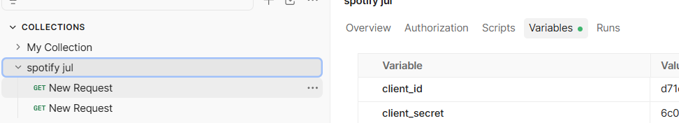
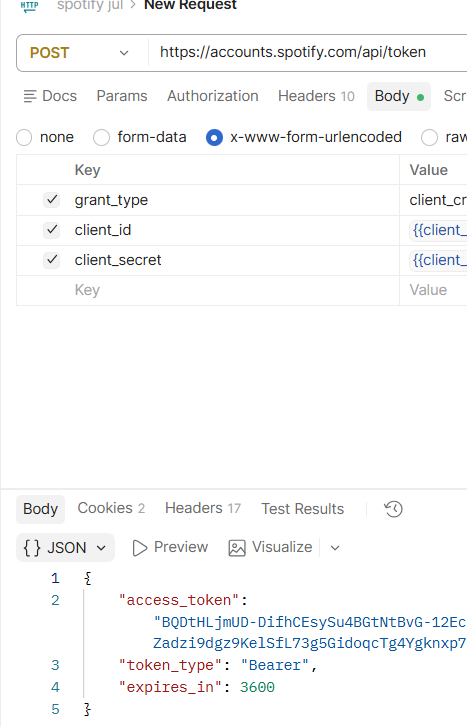
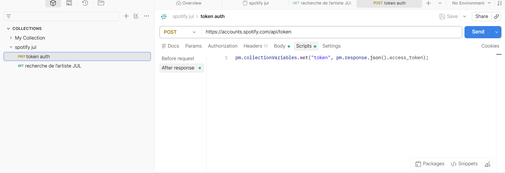
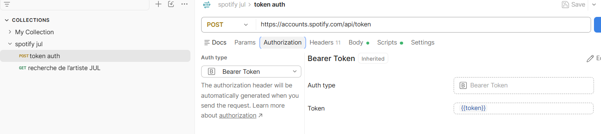
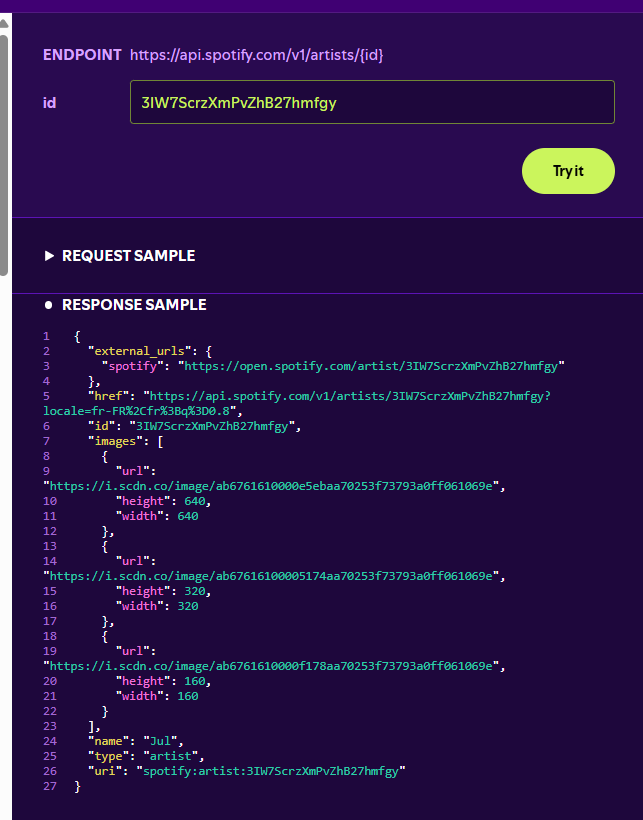

# Notes de travail
## Q1 - Authentification (token)
**Ce que j'ai fait :** creation d'un nouvelle colection stocké client ID et client secret dans les varible et requête POST vers `https://accounts.spotify.com/api/token`
avec `grant_type=client_credentials`, mon Client ID et mon Client t sont stocké dans varible 

**Résultat :** statut 200. La réponse contient un `access_token`,
un `token_type` (Bearer) et `expires_in`.

**Durée de validité :** 3600 secondes, soit 1 heure.

stocker le token automatiquement 

utiliser le token partout

## Q2 - Recherche de l'artiste JUL
**Requête :** GET `https://api.spotify.com/v1/search`
avec les paramètres `q=jul`, `type=artist`, `limit=3`.
Le token est envoyé dans le header `Authorization: Bearer <token>`.

**Résultat :** statut 200. La réponse contient `artists.items` avec 3 artistes.
Le champ `total` vaut 101 : l'API a trouvé 101 artistes, mais n'en renvoie que 3.

**Identifiant de JUL :** **3IW7ScrzXmPvZhB27hmfgy**
check :
https://developer.spotify.com/documentation/web-api/reference/get-an-artist

