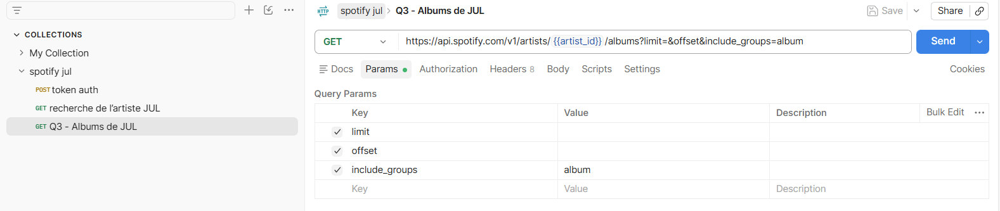
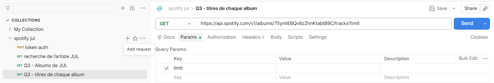
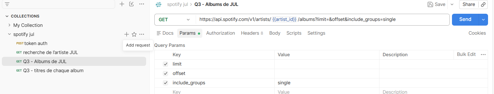
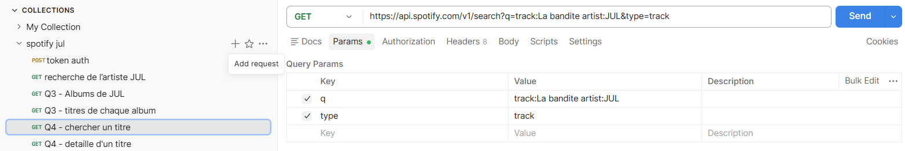
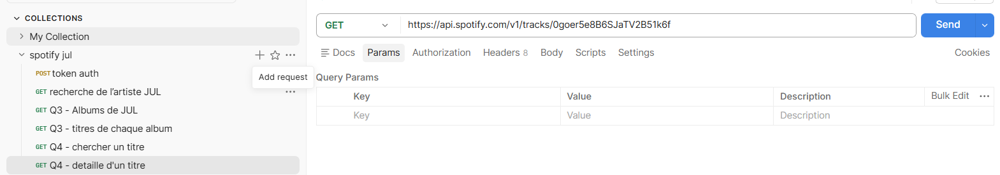
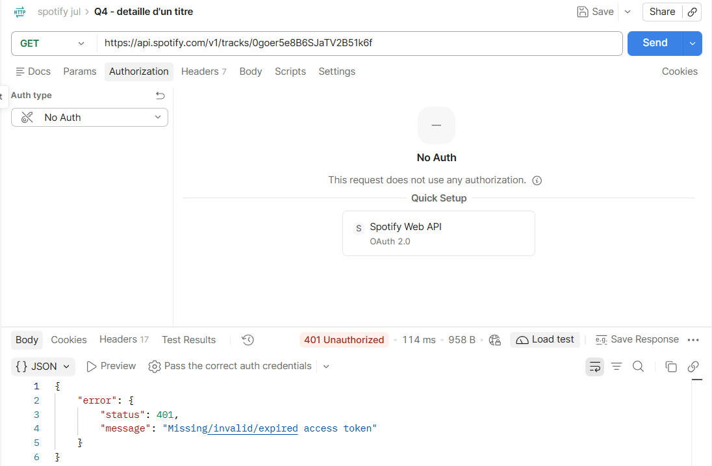
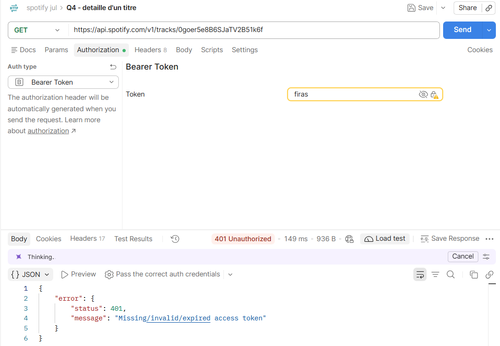
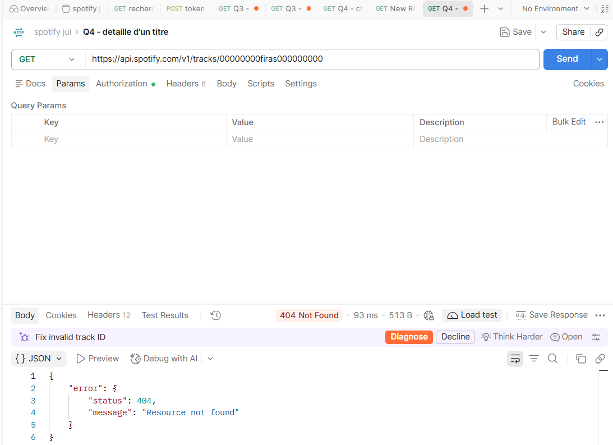
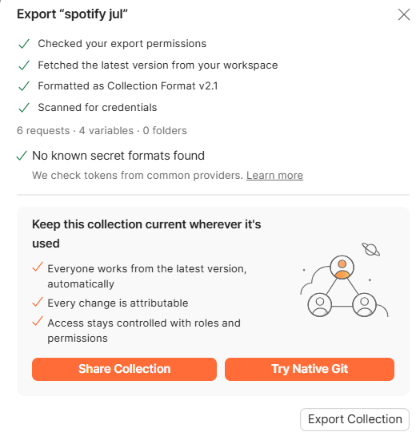

# Notes de travail
## Q1 - Authentification (token)
**Ce que j'ai fait :** creation d'un nouvelle colection stocké client ID et client secret dans les varible et requête POST vers `https://accounts.spotify.com/api/token`
avec `grant_type=client_credentials`, mon Client ID et mon Client t sont stocké dans varible 

**Résultat :** statut 200. La réponse contient un `access_token`,
un `token_type` (Bearer) et `expires_in`.

**Durée de validité :** 3600 secondes, soit 1 heure.

stocker le token automatiquement 

utiliser le token partout

## Q2 - Recherche de l'artiste JUL
**Requête :** GET `https://api.spotify.com/v1/search`
avec les paramètres `q=jul`, `type=artist`, `limit=3`.
Le token est envoyé dans le header `Authorization: Bearer <token>`.

**Résultat :** statut 200. La réponse contient `artists.items` avec 3 artistes.
Le champ `total` vaut 101 : l'API a trouvé 101 artistes, mais n'en renvoie que 3.

**Identifiant de JUL :** **3IW7ScrzXmPvZhB27hmfgy**
check :
https://developer.spotify.com/documentation/web-api/reference/get-an-artist

## Q3 – Discographie : Lister l’intégralité des titres de l’artiste «JUL»

L’API Spotify n’a pas de requête « tous les titres d’un artiste » donc on va devoir récupérer tous les albums de l’artiste, puis tous les titres de chaque album.
pour recupérer les albums de l’artiste
https://developer.spotify.com/documentation/web-api/reference/get-an-artists-albums 

puis pour chaque album récupérer les titres
exemple :
https://api.spotify.com/v1/albums/{id}/tracks
id d'un album : 75ymIEBQv8zZhnKtabtB9C

aprés on recupére les singles :

## Q4 – Détail d'un titre : Affichez les détails du titre « La bandite » de JUL.
- d'abord on recupére l'id du titre "La bandite" de JUL 
https://developer.spotify.com/documentation/web-api/reference/search :

**id du titre : 0goer5e8B6SJaTV2B51k6f**
- detail du titre :
https://developer.spotify.com/documentation/web-api/reference/get-track

## Q5 – Cas d'erreur : Reproduisez au moins trois réponses d'erreur : sans token, avec un token invalide ou expiré, et avec un identifiant de titre inexistant. Notez le code de statut et le corps de chaque réponse.

- **cas 1  Sans token :**

Q4 sans token code de statut : 401

- **cas 2 : token invalide**

Q4 token invalide code de statut : 401

- **cas 3 : identifiant de titre inexistant** 

Q4 identifiant de titre inexistant code de statut : 404
## export collection postman : 

## Difficultés rencontrées et solutions

- **Q1 :** erreur 400 invalid_client. La collection avait une authentification Bearer, héritée par la requête du token. Solution : mettre "No Auth" sur cette requête.

- **Q2 :** erreur 400 "Bad search type field artiste". J'avais écrit type=artiste en français. Solution : écrire type=artist.

- **Q3 :** erreur 400 "Invalid base62 id". J'avais écrit {id} tel quel dans l'URL. Solution : utiliser la variable Postman {{artist_id}}.

- **Q3 :** l'API n'a pas de requête "tous les titres d'un artiste". Solution : récupérer les albums de JUL, puis les titres de chaque album.

- **Q4 :** "La bandite" existe deux fois (album et réédition). Solution : choisir un id. L'ISRC identique permettra de dédoublonner dans le code.